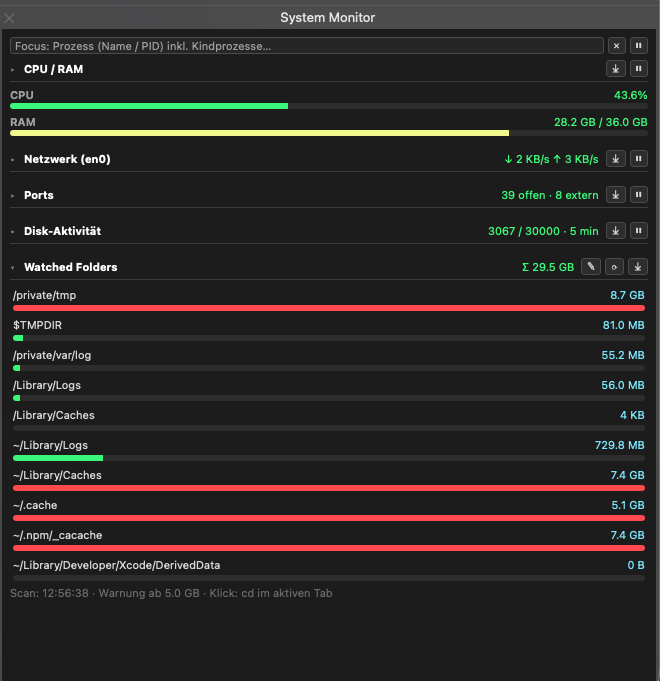

# iTermSysMon

A lightweight macOS system monitor that runs as an iTerm2 web panel.

## Features

- CPU, memory, GPU, network, ports, and file activity
- Process and application usage
- Configurable disk usage monitoring and scan interval for temporary, cache, and build folders
- Configurable process-network sampling interval
- CSV export

## Install

1. In iTerm2, enable **Settings > General > Magic > Python API**.
2. Copy `sysmon.py` and `watched_folders.json` to:
   `~/Library/Application Support/iTerm2/Scripts/AutoLaunch/`
3. Restart iTerm2. The **System Monitor** panel will be available from the toolbelt.

No separate Python installation or package setup is required.

## Watched folders

Edit `watched_folders.json` or add and remove folders in the panel. Set the scan interval to 1–60 minutes, hours, or days. The last scan time and sizes are saved, so restarting iTerm2 does not trigger an unnecessary scan. Default paths avoid nested duplicate scans. The monitor never deletes files; folders over 5 GB are highlighted.

## Network sampling

Set process-traffic sampling to 1–60 seconds or minutes in the Network panel. The default is 10 seconds.

File activity works without administrator access. Process names for file activity require an optional `sudoers` rule for `fs_usage`.